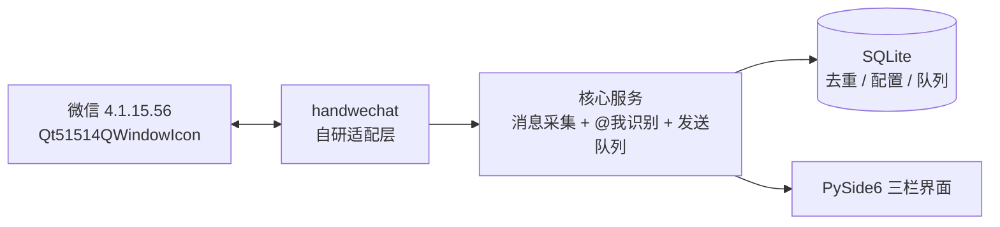

# HandWeChat 微信 PC 端消息收发工具 — 技术方案（v4）

## 一、需求确认

1. 读取微信每个会话的新消息（私聊 + 群聊）
2. 向指定会话发送消息
3. 重点考虑微信后续升级对方案的影响

已明确的约束：

- 不使用企业微信
- 本地微信版本：**4.1.15.56**（新版 Qt 架构，主窗口类 `Qt51514QWindowIcon`）
- MVP 仅实现**纯文字**消息（**不含发送文件和图片**）
- 交付形态：**带界面的 Windows 桌面工具**
- 有专用 Windows 机器长期挂微信，**接受微信自动更新**
- 监听会话规模：**≤100 个**
- 群消息需区分"**@我**"
- 自动化策略：**自研适配层（handwechat，基于 uiautomation）**，wxauto4 仅作 M0 探针与对照参考；API 命名与 wxauto4 对齐

## 二、技术路线选择

| 方案 | 原理 | 抗升级性 | 结论 |
|---|---|---|---|
| UI 自动化（自研 handwechat） | 基于开源 `uiautomation` 读控件树、模拟操作 | 高：代码完全自控，升级只需改 selectors | **采用** |
| UI 自动化（wxauto4 现成库） | 同上，第三方维护 | 中：PyPI 仍在发版，但 GitHub 停更、核心为 .pyd 黑盒 | 仅作 M0 探针/对照 |
| 企业微信 API | 官方 REST 接口 | 最高，但用户已排除 | 不用 |
| DLL 注入 / Hook / 破解库 | 调用内部函数或绕过授权 | 极差：版本强绑定、合规与安全风险 | 排除 |
| 读本地数据库 | 解密 SQLite 消息库 | 差：取密钥需注入，版本强绑定 | 排除 |

**关于 wxauto4 的事实核查**（2026-11 实测）：

- `cluic/wxauto`（GitHub main）硬编码微信 3.9 窗口类 `WeChatMainWndForPC`，不支持微信 4.x
- `cluic/wxauto4` GitHub 仓库已停更，但 PyPI 持续发版（41.1.7，版本号跟微信 4.1.x 走）
- PyPI 版 wxauto4 核心逻辑为编译后的 `.pyd`，仅 `.pyi` 存根可读；可作 API 契约参考，不能作源码参考
- 破解库（wxautox4-Hack 等）存在合规与安全风险，**不采用**

## 三、技术栈

- Python 3.11+
- **uiautomation**（开源 UIA 封装库，自研适配层的基础）
- **PaddleOCR**（群消息发送者昵称兜底识别；Windows OCR 作为降级）
- wxauto4==41.1.7（仅 M0 探针与对照测试，不进运行链路；requirements 中标注 dev-only）
- PySide6（桌面界面）
- SQLite（消息去重、监听配置、发送队列持久化）

## 四、总体架构



### handwechat 包结构

```
handwechat/
├── uia/            # uiautomation 的薄封装：带超时找控件、安全点击、剪贴板
├── selectors.py    # ★所有控件定位规则集中于此，微信升级只改这个文件
├── controls/       # MainWnd / SessionList / ChatBox / EditBox / SearchBox 控件对象
├── msgs/           # BaseMessage / TextMessage / SystemMessage，sender 解析、hash、方向判断
├── wechat.py       # WeChat 门面类，API 命名与 wxauto4 对齐
└── errors.py
```

设计要点：

1. `selectors.py` 是唯一版本适配点：每条定位规则带注释记录"取自 4.1.15.56 实测"，启动自检即逐条验证
2. API 与 wxauto4 同名同签名（`ChatWith`/`SendMsg`/`GetSession`/`GetAllMessage`/`AddListenChat`），将来可一行 import 切换实现
3. 消息 hash 去重：`会话 + 发送人 + 内容 + 位置序号`，为断点续采打底
4. 全局 UI 锁：微信 UI 单线程操作，所有入口串行化（对应 wxauto4 的 uilock 思路）

### 复刻范围分层

| 层 | 内容 | 优先级 |
|---|---|---|
| P0 核心（MVP） | 窗口附加、IsOnline、GetMyInfo、GetSession（私聊/群、未读数、[有人@我]标记）、ChatWith（搜索框定位）、SendMsg（剪贴板+回车）、GetAllMessage（文本、发送人、self/friend/system 分类、hash）、监听机制、@我识别 | 先做 |
| P1 增强 | SendFiles、引用消息解析、右键菜单操作 | 后做 |
| P2 排除 | 语音转文字、朋友圈、笔记、OCR、文件下载等 | 不做 |

## 五、私聊 / 群聊差异处理

- **读消息**：群聊需解析每条消息的"发送人昵称"；自己发的消息与系统消息（入群通知等）识别后过滤或标记类型
- **会话类型判断**：通过会话标题栏区分（群聊带成员数 `群聊(n)`）
- **发消息**：操作路径一致（搜索 → 输入 → 回车）；群聊重名概率高，以"群名 + 成员数"或备注名定位，配置支持别名
- **配置模型**：监听列表每项记录 `类型(私聊/群)`、`微信显示名`、`别名`，启动时校验存在性与类型匹配

## 六、"@我"消息识别

- **判定依据（双保险）**：
  1. 优先利用微信原生标记：会话列表中的 `[有人@我]` 红标
  2. 文本匹配兜底：消息内容包含 `@我的群昵称` 或 `@我的微信昵称`（群昵称优先，从群聊信息获取并缓存，配置页支持手动修正 / 重新获取）
- **数据模型**：消息表含 `is_at_me` 字段；群消息均带 `sender_nickname` 字段
- **界面表现**：@我消息在消息流高亮（红色 `@我` 徽标）；会话列表显示红色 `@` 角标；未读 @我数单独统计；支持"全部 / 只看@我"一键过滤

## 七、监听策略（≤100 会话）

- 不做全会话扫描，采用**显式监听列表**：界面勾选/添加目标会话，程序逐个建立监听状态后轮询采集
- 监听列表内存常驻 + SQLite 持久化，重启自动恢复
- 非监听会话的新消息不采集

## 八、抗微信升级设计（接受自动更新的前提下）

1. **selectors.py 单点隔离**：所有控件定位规则集中一处，微信升级只改这个文件
2. **启动自检**：探测关键控件，任一缺失 → 红色告警"微信版本不受支持，已暂停收发"（停机保护，不会发错会话）
3. **UIA 树快照存档**：M0 产出控件树 dump 存至 `docs/uia_tree/`，微信升级后重新 dump 做 diff，快速定位变化点
4. **版本记录与告警**：记录微信版本号，检测到变化时提示"微信已升级，请验证功能"，内置一键自检按钮
5. **对照测试**：与 wxauto4 同场景对照（仅开发期），验证自研实现的行为一致性

## 九、界面设计（PySide6 单窗口三栏）

- 左栏：监听会话列表（私聊/群图标、未读数、红色 @ 角标、别名）
- 中栏：消息流（群消息显示发送人昵称；@我消息高亮；"全部 / 只看@我"切换）
- 底栏：发送输入框 + 队列状态
- 顶部状态条：微信在线状态、微信版本号、自检结果
- 独立页面：监听配置（添加/移除会话、别名、群昵称刷新）、运行日志

## 十、里程碑

1. **M0 环境探针（先行验证）**：用 wxauto4 验证 4.1.15.56 下能否：枚举会话、读取消息（含群消息昵称与 @我 标记）、向"文件传输助手"发消息；同时用 uiautomation 把主窗口/会话列表/聊天区/输入框控件树 dump 存档到 `docs/uia_tree/`。**通过后才进入开发。**
2. **A1 骨架**：uia 封装 + 窗口附加 + IsOnline + GetSession（会话名、类型、未读数、@我标记）
3. **A2 读消息**：ChatWith + GetAllMessage（文本 + sender + self/friend/system + hash）+ @我判定
4. **A3 发消息**：SendMsg（含群内 @人）+ 发送结果校验
5. **A4 监听**：AddListenChat 轮询回调 + 去重 + 断点恢复
6. **A5 验收**：与 wxauto4 同场景对照测试（同一会话两边读出消息一致）
7. **M2 界面**：三栏界面 + @我高亮/过滤 + 监听配置 + 日志
8. **M3 加固**：自检告警、断线检测、100 会话轮询压测、微信升级应对流程演练

## 十一、已知风险

- 微信 4.x 为 Qt 自绘控件，**文本消息气泡是否暴露可读 UIA 文本是最大未知数**，M0 探针回答；若暴露不全，备选 OCR 消息区（需重新评估工作量）
- 自研适配层初版工作量约 2~4 天（A1~A4），比直接调库慢，但维护权完全自控
- 高频自动发送存在账号风控可能，发送限速（≤20 条/分钟）+ 随机延时；建议使用专用微信号
- 运行期间微信窗口需保持打开（可置于后台，不能关闭）

## 十二、M0 探针结果（2026-11-09 实测，微信 4.1.15.56 + wxauto4 41.1.7）

**结论：M0 全部验证项通过，进入 A1~A5 开发。**

### 激活机制实测（重要修正）

1. **gate 字节热写对 4.1.15.56 无效**：写 1 后根节点类名翻转（`Qt51514QWindowIcon` ↔ `mmui::MainWindow`），但**子树始终不物化**（读屏标志开关、窗口前台化、WM_GETOBJECT 探测均无效）。参考实现宣称的"热写 1 字节立即物化"只在 4.1.15.13 / 4.1.15.53 有效
2. **参考实现的物化校验存在误报坑**：`wake_uia.py` 与 `wechatauto/accessibility.py` 的校验只看根节点类名，4.1.15.56 根节点本来就叫 `mmui::MainWindow`，导致"激活成功"误报（自研层校验必须以"子节点数 > 0"为准）
3. **唯一可靠路径 = 系统"屏幕阅读器"标志（`SPI_SETSCREENREADER`）+ 微信冷启动**：标志开启后重启微信，mmui 控件树完整物化（登录窗口、主窗口均验证通过）
4. **对 A 阶段的影响**：激活逻辑放在"微信启动前"（启动器脚本先设读屏标志再拉起微信），不做运行时热写；读屏标志是系统级会话设置，开机自启脚本需保证每次微信启动前标志已开启

### wxauto4 冒烟测试结果

| 验证项 | 结果 |
|---|---|
| 初始化 + IsOnline + GetMyInfo | 通过（昵称 / 微信号 / 地区均可取） |
| GetSession | 通过：12 个会话，name / time / content / isnew / new_count / ismute |
| 群消息 GetAllMessage | 通过：发送人昵称、消息类型（Time / FriendText / FriendOther-图片）齐全 |
| SendMsg | 通过：向"文件传输助手"发送成功且回读验证（SelfTextMessage） |

### 会话与 @我 的实现注记

- wxauto4 的 Session 无 `@我` 字段；微信在会话格子上的"有人@我"红标与消息文本 `@昵称`（群昵称优先）匹配都在**自研层实现**（方案第六节不变）
- 会话列表当前可见项约 9 个，wxauto4 自动滚动枚举到 12 个；自研层按同样方式滚动 + 去重

### UIA 控件树存档

| 文件 | 内容 |
|---|---|
| `docs/uia_tree/main_window.txt` | 主窗口完整树（85 行） |
| `docs/uia_tree/login_window.txt` | 登录窗口树（二维码登录形态） |
| `docs/uia_tree/nav_summary.txt` | 顶层 + XTab 摘要 |

关键控件定位（自研 selectors.py 基准）：

- 会话列表：`ListControl class='mmui::XTableView' id='session_list'`
- 会话项：`ListItemControl class='mmui::ChatSessionCell' id='session_item_<会话名>'`，Name 含"会话名 / 置顶标记 / 最后一条预览 / 时间"多行文本
- 导航栏：`ToolBarControl class='mmui::MainTabBar'`（微信 / 通讯录 / 收藏 / 发现）
- 聊天区：`GroupControl class='mmui::ChatPage'`；标题栏按钮（置顶 / 最小化 / 最大化 / 关闭）均为 `mmui::XButton`

### 运维注意事项

1. **微信强制结束后需手机扫码重新登录**（4.x 会话失效），日常操作应走微信内退出而非杀进程
2. 每次微信彻底重启后，需确认读屏标志已开启再启动微信（A 阶段启动器自动化）

## 十三、A1 完成记录（2026-11-09）

**自研适配层骨架上线，真机冒烟一次通过。**

### 交付物

| 文件 | 职责 |
|---|---|
| `handwechat/selectors.py` | 全部控件定位规则（4.1.15.56 实测基准，唯一升级适配点） |
| `handwechat/uia/wrapper.py` | uiautomation 薄封装：全局 UI 锁 + 带超时找控件 |
| `handwechat/models.py` | Session 数据模型（name/preview/time/unread/at_me/pinned/type） |
| `handwechat/controls/main_wnd.py` | 窗口附加 + 物化校验（子节点数 > 0，不信根节点类名）+ IsOnline |
| `handwechat/controls/session_list.py` | 会话枚举（滚动去重 ≤100）+ 格子文本解析 |
| `handwechat/wechat.py` | WeChat 门面（API 命名对齐 wxauto4：IsOnline/GetSession） |
| `scripts/start_wechat.py` | 启动器：先设读屏标志再拉起微信（物化前置条件） |
| `scripts/a1_smoke.py` | A1 真机冒烟脚本 |

### 实测结果

| 验证项 | 结果 |
|---|---|
| 附加主窗口 + 物化校验 | 通过（pid/hwnd 正确，读屏标志前置检查） |
| IsOnline | 通过 |
| GetSession | 通过：13 个会话 1.9s，滚动枚举去重正常 |
| 格子解析 | 通过：置顶 / 未读数（[N条]）/ 预览 / 时间 全部正确 |

### 实现注记

1. **群/私聊类型（type）在 A1 恒为 None**：会话格子是 UIA 叶子节点，全部信息只在 Name 多行文本里，属性层无类型线索；类型按方案第五节由 A2 打开会话读标题栏（`群聊(n)`）解析后缓存
2. **@我标记**：解析格子预览行的 `[有人@我]` 前缀（微信原生红标文本化）；真值验证需真实 @我 消息，A4 监听阶段实测
3. **免打扰标志未实现**：格子 Name 中无对应文本标记，wxauto4 的 ismute 来源在 .pyd 黑盒中，MVP 不依赖该字段，后续有需要再攻
4. 附加校验吸取 M0 教训：以"根节点子树非空"为物化判据，避免参考实现的根类名误报坑

## 十四、A2 完成记录（2026-11-09）

**代码与真机冒烟完成，进入 A3。**

### 已落地

| 文件 | 内容 |
|---|---|
| `handwechat/models.py` | 增加 `BaseMessage` / `TextMessage` / `SystemMessage` / `TimeMessage` / `OtherMessage`、`attr`、`type`、`hash`、`is_at_me` |
| `handwechat/selectors.py` | 增加聊天页、消息列表、标题栏、搜索弹窗的 4.1.15.56 定位规则 |
| `handwechat/controls/chat_box.py` | 当前聊天页解析：标题、群/私聊、消息分类、self/friend 方向、群昵称兜底、@我匹配 |
| `handwechat/controls/search.py` | `Ctrl+F` -> 搜索结果精确点选 |
| `handwechat/wechat.py` | `ChatWith` / `CurrentChat` / `GetAllMessage` |
| `scripts/a2_smoke.py` | A2 真机冒烟脚本 |

### 实测结果

| 验证项 | 结果 |
|---|---|
| `compileall` | 通过 |
| 私聊 `ChatWith("文件传输助手")` | 通过，正确返回 Session |
| 私聊 `GetAllMessage` | 通过，读到 10 条 time/text/other 消息 |
| 群聊 `ChatWith("888 种田大队")` | 通过，标题栏识别为群聊 |
| 群聊 `GetAllMessage` | 通过，读到 7 条 time/text/system 消息 |
| self/friend 方向 | 通过，自己的消息标为 `self`，对方消息标为 `friend` |
| 群消息发送者还原 | 通过，OCR 识别出 `哈库拉玛塔塔`、`远方和诗` |
| 消息 `hash` | 通过，消息均有稳定 hash |
| `@我` 判定 | 通过，`@哈库拉玛塔塔一环` 在匹配昵称后 `is_at_me=True` |

### 关键实现结论

1. **微信 4.1.15.56 的消息项在 UIA 中仍是叶子节点**：`ChatTextItemView` 只有 Name 保存正文，不再暴露子控件保存群昵称；群发送者昵称必须用消息顶条图像识别兜底。
2. **Windows OCR 在本机不可靠**：`zh-Hans-CN` 语言包存在，但对生成中文图和消息裁图均返回空。因此 OCR 主路径调整为 **PaddleOCR**，Windows OCR 只作为未安装 Paddle 时的降级路径。
3. **群消息顶条裁剪取消息项顶部 36px**：这个高度能覆盖昵称行，避免昵称被截断。
4. **消息模型保留 `hash` 与 `runtime_id`**：A4 监听阶段将以 `hash` 作为去重主键，`runtime_id` 只用于调试和短期 UIA 定位辅助。

### 依赖变更

新增 `requirements.txt`，当前运行链路依赖：

- `uiautomation`
- `Pillow`
- `paddleocr`
- `paddlepaddle`

`wxauto4` 仍只在 M0 探针/对照测试中使用，不进入 `handwechat` 运行链路。

## 十五、A3 完成记录（2026-11-09）

**纯文本发送链路完成，私聊与群聊均已真机验证。**

### 交付物

| 文件 | 职责 |
|---|---|
| `handwechat/controls/chat_box.py` | 增加 `send_text`：点击输入框 -> 清空 -> 剪贴板粘贴 -> 回车发送；粘贴后校验输入框非空，非空才回车 |
| `handwechat/controls/chat_box.py` | 增加 `wait_for_self_text`：轮询消息列表，确认指定文本已成为最新 `self` 方向 `TextMessage` |
| `handwechat/wechat.py` | 增加 `SendMsg(msg, who=None, clear=True, at=None, exact=False, verify=True, verify_timeout=4.0)`；必要时切会话，成功回读返回 `TextMessage` |
| `scripts/a3_smoke.py` | A3 真机冒烟脚本：附加微信 -> 搜索目标会话 -> 发送带时间戳文本 -> 回读校验 -> 输出最后 3 条消息 |

### 实测结果

| 验证项 | 结果 |
|---|---|
| 私聊“文件传输助手”发送 + 回读 | 通过，`SendMsg` 返回 `TextMessage`，`GetAllMessage` 包含发送文本 |
| 群聊“888 种田大队”发送 + 回读 | 通过，`SendMsg` 返回 `TextMessage`，`GetAllMessage` 包含发送文本 |
| 粘贴后输入框非空校验 | 通过，可防止剪贴板/焦点异常时回车发送旧内容 |
| `compileall` | 通过 |

### 真实 @ 人探针结论

已用键盘输入方式探针群聊 `@人`：候选弹层是否出现、候选层定位时机和键盘序列都不稳定。为了避免发出“内容里有 @，但微信没有形成真实提及关系”的假 @ 消息，MVP 不启用真实 @ 人。

当前接口策略：

1. `SendMsg` 保留 `at` 参数，但传入非空 `at` 会抛 `NotImplementedError`。
2. 需要提示某人时，调用方可在纯文本里手写 `@昵称`；这不会构成微信原生提及，也不会可靠触发对方的“@我”提醒。
3. 后续如继续攻坚，应以微信输入框的候选人控件/浮层为准，而不是继续依赖固定键盘序列。

### 实现注记

1. 发送链路使用剪贴板粘贴，不逐字符模拟输入，避开中文输入法改写；发送结果通过消息区回读校验。
2. `SendMsg` 默认持全局 UI 锁执行“确认当前会话 / 搜索切换会话 / 输入发送 / 回读”整段动作，避免并发 UI 操作互相踩踏。
3. `verify=False` 时只完成输入与回车动作，返回 `None`；`verify=True` 超时未回读到内容时也返回 `None`，便于调用方按失败处理。
4. 发送限速（如 ≤20 条/分钟）不在 A3 内实现，放到 A4 监听或 M3 加固阶段统一处理。
5. 微信 UIA 子树在长期运行时可能周期性“收起”：窗口仍可见，但 `GetChildren()==0`。实测用 `ShowWindow(hwnd, SW_RESTORE)` + `SetForegroundWindow(hwnd)` 可恢复控件树。长期挂机机器不能把微信主窗口收进托盘，M3 需要增加自动恢复与告警。

### 阶段状态

A3 完成。下一阶段 A4 进入消息监听：`AddListenChat` 风格会话监听、轮询回调、`hash` 去重和断点恢复。

## 十六、A4 完成记录（2026-11-09）

**纯文本消息监听链路完成，真机冒烟通过。**

### 交付物

| 文件 | 职责 |
|---|---|
| `handwechat/wechat.py` | 新增 `GetMessagesFrom(who, my_names=None, timeout=4.0)`；将“确认/切换会话 + 读取消息”包在同一把 `ui_lock` 内，避免监听线程与发送线程交替切换会话时读错页面 |
| `handwechat/listener.py` | 新增 `MessageListener`：`AddListenChat` / `RemoveListenChat` / `GetAllListenChat` / `PollOnce` / `Start` / `Stop` / `SetMyNames` / `AddMessageCallback` / `AddErrorCallback` / `GetListenState` |
| `handwechat/__init__.py` | 导出 `MessageListener` 与 `ListenState` |
| `scripts/a4_smoke.py` | 真机冒烟脚本：附加微信 -> 监听“文件传输助手” -> 发送带唯一时间戳文本 -> 15 秒内断言回调收到该文本 |

### 实测结果

| 验证项 | 结果 |
|---|---|
| 真机监听“文件传输助手” | 通过 |
| 发送唯一时间戳文本后回调接收 | 通过，回调收到 `HandWeChat A4 listen test ...`，`listen_seq=2` |
| 同轮时间戳消息 | 通过，时间行先回发出 `seq=1`，正常文本 `seq=2` |
| 新消息只发一次 | 通过，同一文本没有被重复回调 |
| 复验时的会话搜索定位 | 通过，已兼容 `search_item_*_目标名` 形式的 AutomationId，并保留精确 Name 兜底 |
| 纯逻辑回归 | 通过，覆盖新增尾部提取、无锚点跳过、同人重复文本、断点恢复不重复发旧消息 |

### 实现注记

1. **去重不使用 `BaseMessage.hash`**：`hash` 含 UIA index，消息列表滚动后 index 会漂移。A4 改用内容语义指纹：`type + attr + sender + content`。
2. **断点状态保存最近 128 个语义指纹**：保存到 `data/listener_state.json`，使用临时文件加原子替换写入；重启后通过尾部连续片段匹配只补发新增消息。
3. **轮询成功后必须同步更新 `recent_keys`**：否则进程重启会把上一轮已经回调过的消息重复发一遍。
4. **断点锚点不在当前消息窗口内时跳过本轮**：返回错误并等待下一轮，宁可漏报，也不把窗口外的旧数据误报为新消息。
5. **`RemoveListenChat` 只把会话标记为停用，不删除断点**：重新添加同一会话时可以继续从旧锚点恢复。
6. **每条新消息分配会话内单调递增 `listen_seq`**：写入 `msg.extra["listen_seq"]` 与 `msg.extra["listen_time"]`，便于调用方排序与排查。
7. **后台守护线程轮询**：单次轮询失败不终止监听；单个消息回调异常也不影响其他回调。
8. **监听上限 100 个活跃会话**：符合当前 MVP 约束。
9. **MVP 仅支持纯文本**：`savepic` / `savefile` / `savevoice` 传入非默认值时抛 `NotImplementedError`，媒体保存留给后续阶段。
10. **UI 并发保护**：所有读取当前消息的 UI 动作都持有 `handwechat/uia/wrapper.py` 的 `ui_lock`；监听轮询和发送会共用这条锁。
11. **搜索结果定位不能只按完整 AutomationId 匹配**：复验发现 4.1.15.56 的结果 ID 可能为 `search_item_function_目标名` 这类带类型段的形式；现在按 `search_item_` 前缀加精确 `Name` 匹配，再回退到仅精确 `Name` 匹配。

### 遗留事项

1. 监听轮询会切换当前聊天页，可能抢占用户正在手动操作的微信界面。M2/M3 需要在界面层给出“运行中/暂停监听”的明确控制。
2. 群聊“@我”已由消息模型提供判定字段，但真实 @ 我消息的真值验证还需要后续用真实 @ 我场景补测。

### 阶段状态

A4 完成。下一阶段 A5 进入对照验收，再进入 M2 界面与 M3 加固。

## 十七、A5 完成记录（2026-11-09）

**A5 对照验收通过，私聊与群聊均已在真机上对齐。**

### 交付物

| 文件 | 职责 |
|---|---|
| `scripts/a5_compare.py` | 纯读取对照脚本：handwechat 打开目标会话，wxauto4 只读取同一当前会话；以 wxauto4 可见的最新文本消息为锚点，在 handwechat 读到的消息中找同一条并比较归一化字段 |

### 实测结果

| 会话 | 结果 |
|---|---|
| 私聊“文件传输助手” | 通过，handwechat 和 wxauto4 读到同一条 `self/text` 消息 |
| 群聊“888 种田大队” | 通过，handwechat 和 wxauto4 读到同一条 `friend/text` 群消息，发送者和内容一致 |

### 对照口径

1. **不发送测试消息，只做读取对照**：脚本以 wxauto4 当前可见的最新文本消息作为锚点，再用 handwechat 在同一当前会话里查找同一条消息。
2. **消息归一化字段为 `type + attr + sender + content`**：`sender` 统一转小写，避免 wxauto4 的 `self` 与 handwechat 的 `Self` 因为大小写差异误报。
3. **不使用 wxauto4 的 `ChatWith` 作为会话切换依据**：本轮实测它的搜索定位在当前微信界面上不稳定，所以会话切换由 handwechat 完成，wxauto4 只负责读取当前会话。

### 已知限制

1. **wxauto4 当前读不到最新一条消息**：它在“文件传输助手”上读到的是上一条 A4 测试消息，而不是刚发送的 A5 测试消息。因此脚本改为以 wxauto4 可见的最新文本消息为锚点，而不是要求两边都读到最新消息。
2. **wxauto4 的搜索定位不稳定**：不影响 A5 结论，但说明第三方库本身对当前界面状态也有兼容性问题，继续自研 handwechat 是正确方向。

### 阶段状态

A5 完成。下一阶段 M2 进入三栏界面、监听配置、消息流展示、@我高亮/过滤和运行日志。

## 十八、M2 完成记录（2026-11-09）

**PySide6 三栏界面完成，离屏真机冒烟通过。**

### 交付物

| 文件 | 职责 |
|---|---|
| `handwechat/gui/config.py` | GUI 配置持久化（监听会话、别名、@我昵称、轮询间隔） |
| `handwechat/gui/workers.py` | `FunctionWorker` / `SendWorker` / `ListenerBridge` / `WeChatController`，把 UIA 与监听线程桥接到 Qt 信号 |
| `handwechat/gui/main_window.py` | 主界面：左栏监听会话列表、中栏消息流、底栏发送输入框、监听配置页、运行日志页 |
| `scripts/run_gui.py` | GUI 启动入口 |
| `scripts/m2_smoke.py` | M2 冒烟：离屏窗口 + 真机附加/监听/发送回读 |

### 实测结果

| 验证项 | 结果 |
|---|---|
| `compileall` | 通过 |
| GUI 附加微信 | 通过，PID/HWND 正确 |
| 自动恢复监听配置 | 通过，“文件传输助手”成功加入监听 |
| GUI 消息流渲染 | 通过，测试文本正常显示 |
| GUI 发送队列 | 通过，发送后消息流收到回读文本 |
| 关闭界面 | 通过，监听与发送线程正常停止 |

### 实现注记

1. **监听回调线程 -> Qt 主线程**：`MessageListener` 的回调通过 `ListenerBridge` 的 Qt 信号转发，界面只在主线程更新消息流、未读数和 @我角标。
2. **发送队列串行化**：`SendWorker` 独立线程消费发送队列，避免 GUI 输入事件和监听轮询并发争抢微信 UI。
3. **COM/UIA 初始化**：`FunctionWorker` / `SendWorker` / `MessageListener._run` 都在各自线程内使用 `uiautomation` 的 `UIAutomationInitializerInThread`，解决 “CoInitialize 未调用” 错误。
4. **@我过滤与未读状态**：左栏显示未读数和“有@我”标记；中栏可按“只看@我”过滤；选中会话后清除该会话的未读与 @我提示。
5. **会话列表刷新防递归**：`_refresh_session_list` 增加重入保护，避免 `QListWidget.currentItemChanged` 信号和列表重建互相触发。
6. **配置持久化**：监听会话、别名、@我昵称、轮询间隔保存在 `data/gui_config.json`；监听断点仍由 A4 的 `data/listener_state.json` 负责。
7. **MVP 保持纯文本**：界面发送框只接受纯文本；媒体消息仅显示“暂不支持的消息类型”占位。

### 阶段状态

M2 完成。下一阶段 M3 进入加固与长期挂机稳定性：UIA 子树恢复、发送限速、会话上限压测、升级自检和异常恢复。

## 十九、M3 完成记录（2026-11-09）

**加固层完成：升级自检、UIA 子树恢复、发送限速、100 会话逻辑压测均通过。**

### 交付物

| 文件 | 职责 |
|---|---|
| `handwechat/selfcheck.py` | 关键 UIA 控件自检：主窗口 / 会话列表 / 导航栏 / 当前聊天区 |
| `handwechat/version_info.py` | 读取微信进程可执行文件版本号 |
| `handwechat/health.py` | 周期健康监测、版本基线、UIA 控件树恢复尝试 |
| `handwechat/rate_limit.py` | 发送令牌桶限速 + 随机抖动 |
| `handwechat/controls/main_wnd.py` | 新增 `recover_tree()`：恢复收起/失效的 mmui 控件树 |
| `handwechat/wechat.py` | 新增 `Recover()` 对外门面 |
| `handwechat/gui/main_window.py` | 顶部状态栏新增版本、自检状态和手动自检按钮；配置页新增发送限速 |
| `handwechat/gui/workers.py` | GUI 控制器接入健康监测、发送限速和健康信号桥接 |
| `scripts/m3_smoke.py` | 自检 + 版本基线 + 限速 + 100 会话逻辑压测 |

### 实测结果

| 验证项 | 结果 |
|---|---|
| `compileall` | 通过 |
| 真机自检 | 通过：主窗口 / 会话列表 / 导航栏 / 当前聊天区均定位成功 |
| 微信版本识别 | 通过：4.1.15.56，版本基线首次写入 |
| 发送限速 | 通过：3 次发送耗时约 2.86 秒，抖动生效 |
| 100 会话逻辑压测 | 通过：100 个监听会话恢复与单轮轮询无异常 |
| M2 GUI 回归 | 通过：界面附加、消息流、发送回读、线程退出正常 |

### 实现注记

1. **升级自检策略**：每次自检不切换会话，只做控件存在性检查；当前聊天区未打开时标记为跳过，不误报。版本基线写入 `data/version_baseline.json`。
2. **版本变化告警**：健康监测发现微信版本与基线不同时记日志；但不会阻止下一次自检继续执行，便于用户判断升级后是否仍可使用。
3. **UIA 子树恢复**：`recover_tree()` 先恢复窗口前台并等待子树重新物化，仍失败时重新附加窗口；不会杀微信进程。
4. **失败保护**：自检失败会暂停监听并阻止 GUI 发送；恢复成功后，如果失败前监听是运行状态，会自动恢复监听。
5. **发送限速**：默认 20 条/分钟，使用令牌桶并叠加 0.4~1.2 秒随机抖动；GUI 配置页可调，修改后立即生效。
6. **100 会话压测口径**：使用 FakeWeChat 验证 `MessageListener` 在 100 个显式监听会话下的恢复与轮询路径，不污染真实微信状态；真实微信的 UI 升级兼容性仍由自检负责。

### 阶段状态

M3 完成。当前项目进入可用稳定版状态，后续可按微信实际升级做 selectors 局部适配。

## 二十、监听锚点失配修复记录（2026-11-10）

**修复群聊 sender 不稳定导致监听反复跳过的问题。**

### 根因

1. A4 的消息语义指纹为 `type + attr + sender + content`，其中群聊 `sender` 依赖 OCR/昵称行解析。实测它可能出现群名、时间文本等错误值，并在刷新后变化。
2. 程序重启后，`recent_keys` 里可能仍保存着昨晚的旧锚点；当前消息窗口只保留最近几条时，新旧 key 无法形成重叠片段。此时 `_diff_messages()` 持续返回失配，监听器只会反复报“断点锚点不在当前消息窗口内”，无法恢复。
3. 该问题不是群名变更导致的；群名本身只是出现在错误解析的 `sender` 字段里。

### 修复

| 文件 | 修改 |
|---|---|
| `handwechat/listener.py` | `_message_key()` 改为 `type + attr + content`，移除不稳定的群聊 `sender` |
| `handwechat/listener.py` | 新增 `_has_key_overlap()`；`AddListenChat()` 发现旧锚点与新窗口无重叠时重建 `recent_keys` 基线，不回调旧消息 |
| `handwechat/listener.py` | `ListenState` 增加 `anchor_misses`；轮询中连续 3 次锚点失配时自动重建消息基线并告警，成功匹配后清零 |
| `handwechat/listener.py` | `anchor_misses` 纳入状态序列化/反序列化；`AddListenChat()` 重建基线时同步清零 |

### 实测结果

| 验证项 | 结果 |
|---|---|
| `python -m compileall -q handwechat scripts` | 通过 |
| FakeWeChat 恢复回归 | 通过：模拟旧锚点滚出窗口、群聊 sender 变化后，监听器连续失配 3 次自动重建基线；新消息只回调一次，未误报旧消息 |
| `scripts/m2_smoke.py` | 通过：GUI 附加微信成功，自检 4 项通过，发送后收到回读文本；监听配置恢复为「888 种田大队」 |
| 群聊监听检查 | 通过：监听「888 种田大队」20 秒无锚点失配错误，状态文件中 `anchor_misses=0` |

### 行为说明

1. 修复后，旧锚点滚出当前窗口不会再导致永久跳过；最多连续 3 轮后重建基线。
2. 重建基线只记录当前可见窗口，不把旧消息当作新消息回调；之后新进入窗口的消息会正常回调。
3. 由于指纹不再包含群聊 `sender`，同一内容不同发送人的消息仍可通过尾部片段匹配区分；极端情况下连续完全相同文本的误报风险与 A4 原设计一致。
